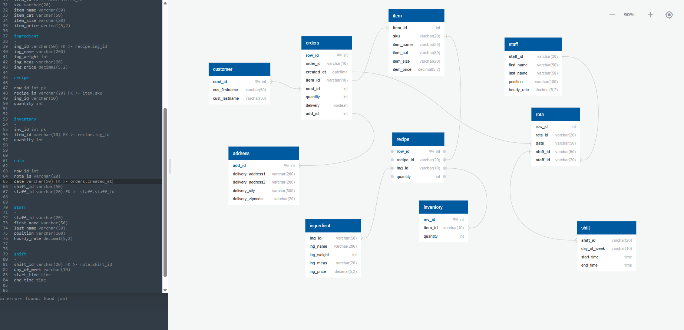
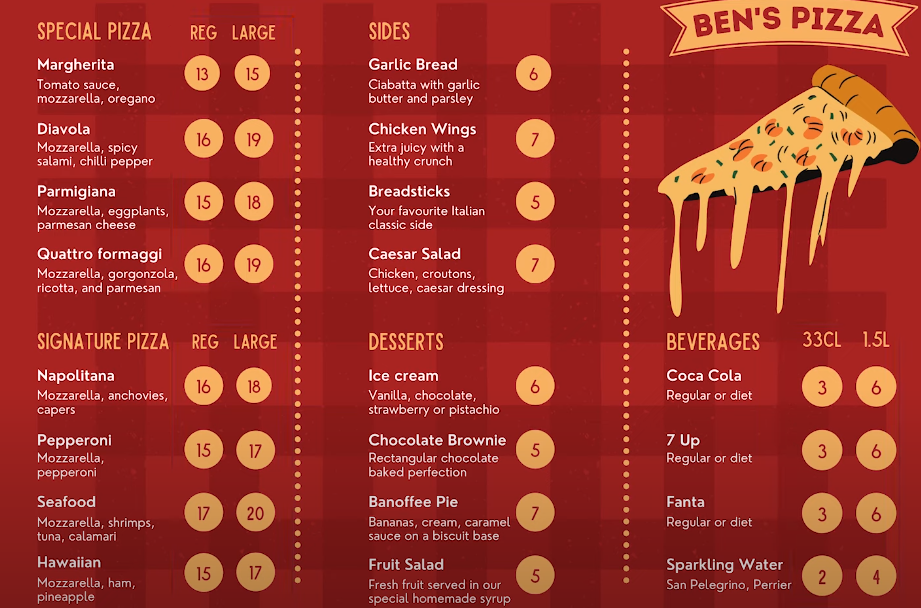
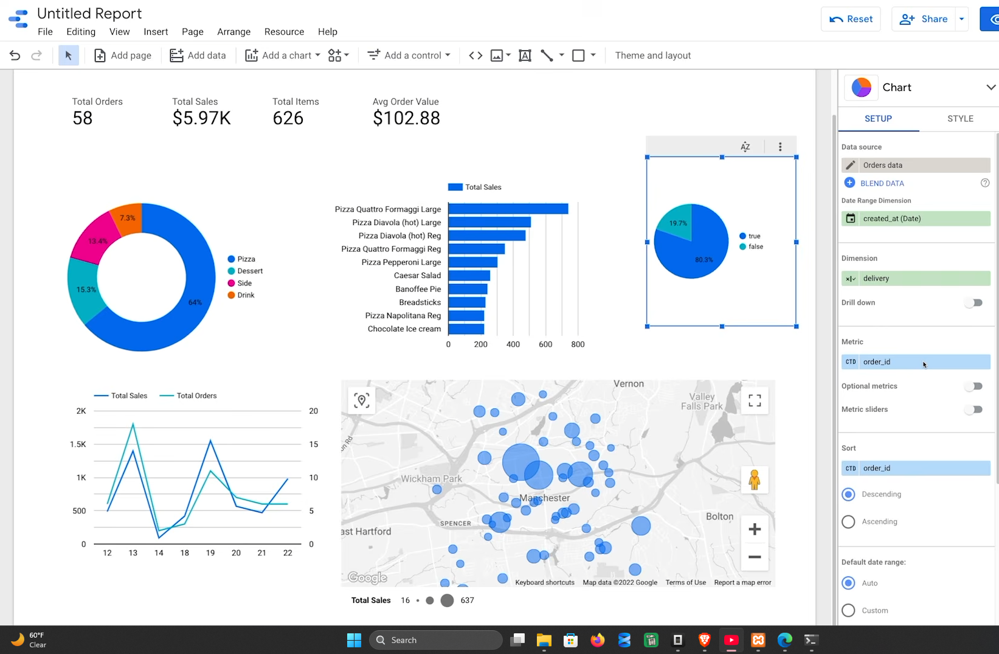
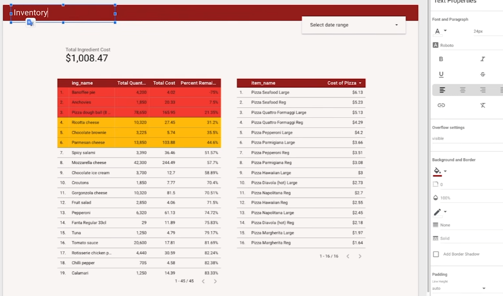
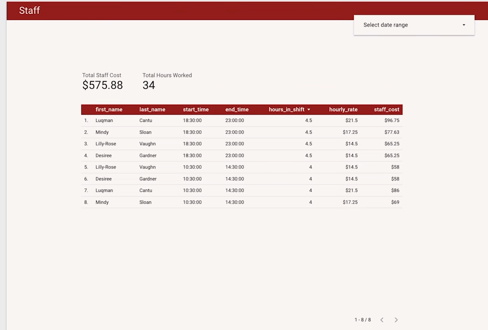

# CrustMetrics

SQL and Looker Studio analytics for a takeout and delivery pizza shop: sales, ingredient cost and stock, and staffing cost.

## Goal

Answer three questions for a new pizza shop owner:

1. **Orders:** what sells, when, where and how (delivery or pick-up)?
2. **Inventory:** what do the ingredients cost, what does each pizza cost to make, and what is running low?
3. **Staff:** how many hours are worked and what do they cost?

## Data

Synthetic data generated with Mockaroo, about 3,000 order lines across 1,135 orders, 300 customers and addresses, 37 menu items, 42 ingredients, 16 staff and 14 shifts.

| File | Contents |
|---|---|
| `customers.csv`, `addresses.csv` | Customers and delivery addresses |
| `menu_items.csv` | Menu with SKU, category, size, price |
| `orders.csv` | One row per order line |
| `ingredients.csv`, `recipes.csv`, `inventory.csv` | Pack sizes and prices, quantity per menu item, stock on hand |
| `staff.csv`, `shifts.csv`, `rotations.csv` | Staff, shift definitions, who worked when |
| `export_*.csv` | Query results used by the dashboards |

The menu the data is based on:

## SQL

Run in order on MySQL 8.

| Script | Purpose |
|---|---|
| `sql/00_schema.sql` | Creates the `crust_metrics` database, ten tables and foreign keys |
| `sql/01_order_activity.sql` | Flat order table for dashboard 1 |
| `sql/02_inventory_cost.sql` | Ingredient usage view, stock remaining, cost per pizza |
| `sql/03_staff_cost.sql` | Hours and cost per shift for dashboard 3 |
| `sql/04_extra_analysis.sql` | Revenue by category, top items, delivery vs pick-up, revenue by hour, margin per item |

## Dashboards

Built in Google Looker Studio from the query exports.

### Order activity

Total orders, sales, items and average order value, plus sales by category, top-selling items, orders and sales by hour, orders by location and delivery vs pick-up.

### Inventory

Total ingredient cost, quantity and cost per ingredient, percentage of stock remaining (red and amber highlight low stock), and ingredient cost per pizza.

### Staff

Total staff cost and hours worked, with cost per person per shift, filterable by date range.

## Tools

MySQL 8, Google Looker Studio, QuickDBD (schema diagram), Mockaroo (source data).

## Author

Ayoub Hssine
